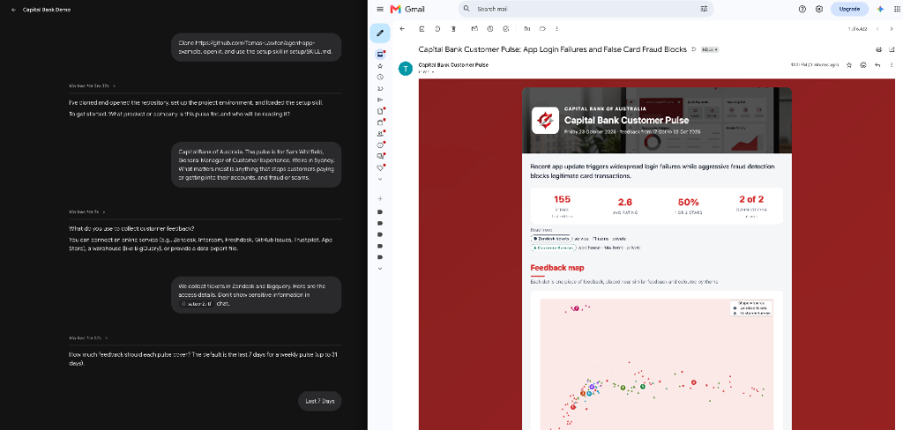
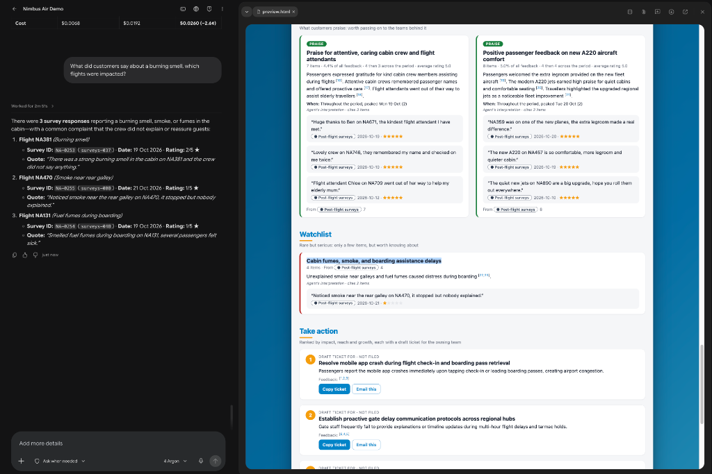
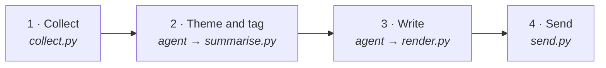

<div align="center">

# PoC: Customer Pulse

**A weekly pulse on what your customers are saying, run entirely by the AI agent you already use.**

A proof of concept for an *agent as an application*: no app to deploy, just skills, a few small scripts, and checks every pulse must pass. It's here to show the idea and invite critique, not to run in production as is. It goes with the article [Effective AI Agents Don't Need Workflows](https://buildonsundays.substack.com/p/effective-ai-agents-dont-need-workflows).

</div>

## Quick start

In any agent harness (Antigravity, Gemini CLI, Claude Code, Codex…), say:

```text
Clone https://github.com/Tomas-Lawton/poc-harness-driven-application, open it, and use the setup skill in setup/SKILL.md.
```

The [setup skill](setup/SKILL.md) asks a few questions, connects your feedback sources, then runs and sends your first pulse. After that, just ask: *"why is the top theme growing?"*, *"make it shorter"*, *"add our survey export"*.

**Try it with no accounts.** Add *"and try it with the example data"* to that prompt. Setup then uses 300 feedback items from Nimbus Air, a fictional airline ([example/nimbus-air-feedback.csv](example/nimbus-air-feedback.csv)), moved so the newest is today, and shows the pulse in the chat.

**What it needs.** It's harness-first: there's no server or UI to install. You need an agent harness that can read files and run shell commands, a capable model, and Python 3.11 or newer (the agent creates a local `.venv` itself). A pulse over a few hundred items takes around 20 minutes in testing, and reading every item uses your harness's tokens.

## What you get





Two fictional clients: Capital Bank, set up in the chat and emailed its first pulse, and Nimbus Air, answering a follow-up question from its feedback. Each pulse has:

- **Things to act on:** up to three actions, each with an owner and a draft ticket for the team.
- **What customers are saying and what's working:** the main themes with quotes and sources, a feedback map, and charts counted by code.
- **A watchlist:** rare but serious feedback, such as scams or vulnerable customers.

## Why an agent, not a workflow

A workflow, or a normal app with model calls, fixes the path in code: fetch, prompt, parse, render. Every new source, question or change of emphasis is a code change, and the model only fills in the blanks. Here the agent runs the whole job, and code does only what code is better at: reading connections, counting, checking and sending. You change the pulse by talking to it, ask follow-ups in the same conversation, and add a source through setup rather than a release.

There is no orchestration in code. No program calls the model, strings the steps together or decides what runs next. The harness reads the skill, decides the order, and runs each step's script itself as a shell command. Each script does one exact job (collecting, counting, checking, building the page or sending), checks the agent's work and exits, telling the harness what to fix or what comes next.

The trade-offs are real. A run is slower and uses more tokens than a fixed pipeline. The writing varies from run to run, within what the checks allow. It depends on the harness and model you bring. And the guarantees are only as strong as the checks plus your harness's permissions (see [Trust boundaries](#trust-boundaries)).

## How it works

**The harness** is the AI agent you already use. It does the judgement: it reads every piece of feedback, finds the themes, writes the pulse and answers your follow-up questions. Its limits come from setup, not from the run.

**The skill** is the use case: the instructions the harness follows to make a Customer Pulse, the same for every client. Only the developer changes it.

**The profile** is the client: a few settings, then their own words on who reads the pulse, what matters and the tone. You can change it any time, and it only changes how the pulse is presented.

**The user scope** is the client's reach: which connections the pulse may read, who it may email and when it runs. Only setup changes it, and only with your confirmation. The scripts refuse any user scope that goes beyond the use case scope, the most any pulse may do.

**The engine** is the scripts that end each step. They collect the feedback (read only, from approved connections), count everything, check the harness's work and build the pulse, stopping with what to fix if anything is wrong. How it's organised: [engine/README.md](engine/README.md).



| Step | The agent | The scripts |
|---|---|---|
| **1. Collect** | | Read your connections, remove emails, phone numbers and long numbers, keep the newest 500 items, group similar ones |
| **2. Theme and tag** | Reads every item, writes the themes, tags every item | Check the tags, count each theme, compute trends |
| **3. Write** | Picks the actions, writes the pulse with citations | Check the writing, build the pulse and email |
| **4. Send** | Presents the pulse, answers follow-ups | Rerun every check; email only your approved recipient |

## Trust boundaries

**Enforced by code, every run:** every item is tagged, every quote appears word for word in the feedback, every number comes from code, every sentence cites the items it rests on, every connection and recipient is in the user scope, and the send script emails only after all of that passes.

**Left to the agent:** the judgement (which themes matter, and whether a summary fairly reflects the items it cites) and following the skill. The harness can run commands, so it could reach a service or send mail without the scripts. The skill tells it not to; your harness's sandbox and permissions are what actually stop it.

**Checked by a second look:** a fresh sub-agent that sees only each claim and the items it cites confirms the claim is supported. This is required before a scheduled run sends. In a conversation it's recommended, and without a sub-agent the harness checks its own writing.

## Checks and tests

**Checks test the agent, every run.** They're part of the product: the checks above end every step and catch the agent's mistakes, live, on real data.

**Tests test the checks, whenever the code changes.** They're for the developer. They feed the checks deliberately broken work (an invented quote, a guessed number, an uncited sentence, a connection outside the user scope) and confirm each one is caught. Run them with `pytest`.

## Known limits

**No evals yet.** The checks prove each pulse is grounded (quotes are real, numbers are counted, claims are cited), not that it is good: that the themes are the right ones, the actions sensible and the summaries fair. This proof of concept was built with fictional clients and synthetic feedback. A real deployment needs evals for the judgement code can't check: a fixed feedback set labelled by people, run headless whenever the skill or model changes, scoring how closely the agent's tags match the labels, how many claims the second look confirms, and whether the main themes stay the same across runs and models.

**Tested in one harness so far.** It is written for any harness that can run commands, but it has only been run end to end in one.

---

<div align="center">
<sub>MIT licensed.</sub>
</div>
